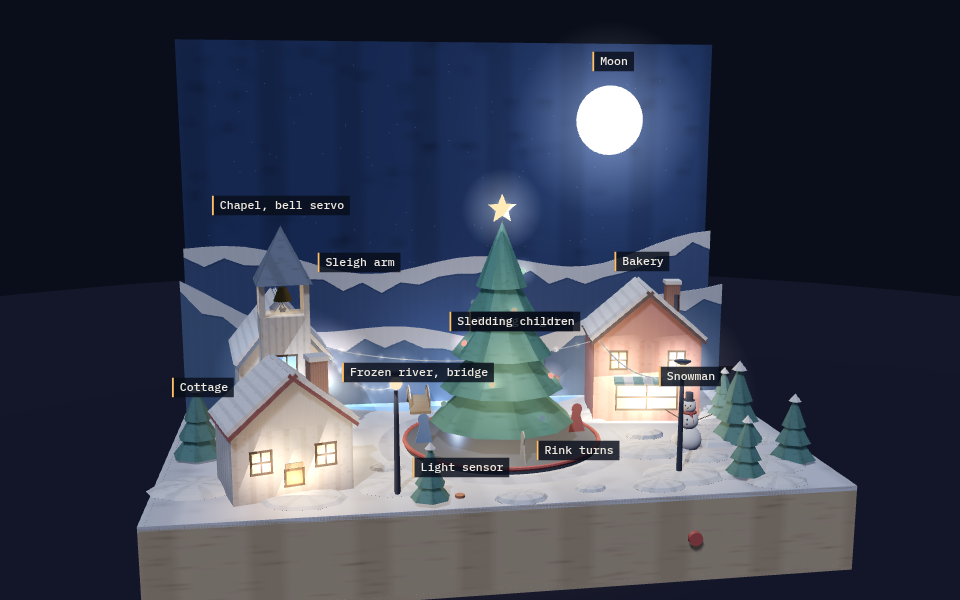

# Lantern Square

A 70 × 45 cm cardboard Christmas village with an Arduino Nano hidden in the base.
It wakes when the room goes dark and runs a five-part evening show.

Live concept page with 3D model and wiring diagram:
https://claude.ai/artifact/FHZcgud7m9V3Vm3JpK5WeD
(`concept/concept-page.html` is a local copy of its source. It needs the artifact viewer's wrapper or a browser, and internet for the 3D library.)

| Path | Contents |
|---|---|
| [docs/01-concept.md](docs/01-concept.md) | What the model is and does |
| [docs/02-hardware.md](docs/02-hardware.md) | Pins, PCA9685 channels, wiring rules, power |
| [docs/03-firmware.md](docs/03-firmware.md) | Firmware behaviour and constraints |
| [docs/04-parts.md](docs/04-parts.md) | Parts owned and parts to buy |
| [docs/05-open-questions.md](docs/05-open-questions.md) | Decisions still needed |
| [docs/06-turntable.md](docs/06-turntable.md) | Turntable mechanism design |
| [docs/07-houses.md](docs/07-houses.md) | House sizes, openings, materials |
| [docs/08-tree.md](docs/08-tree.md) | Christmas tree: cones, pixels, assembly |
| [docs/inventory.txt](docs/inventory.txt) | Plain list of every owned part (the record; the photos were removed) |
| [concept/concept-page.html](concept/concept-page.html) | Source of the live concept page |
| [drawings/templates/house-templates.pdf](drawings/templates/house-templates.pdf) | Printable 1:1 cutting templates for the three houses |
| [drawings/templates/tree-templates.pdf](drawings/templates/tree-templates.pdf) | Printable 1:1 cutting templates for the tree |
| [drawings/scene.png](drawings/scene.png) | Screenshot of the 3D concept model, shown at the top of this README |
| [drawings/turntable-section.svg](drawings/turntable-section.svg) | Turntable cross-section drawing, opens in any browser |
| `tools/house-templates.py` | Draws the house templates into `drawings/templates/` |
| `tools/tree-templates.py` | Draws the tree templates (uses house-templates.py) |
| `tools/turntable-section.py` | Draws the turntable SVG |

Firmware will go in `firmware/` when it starts.

## Guiding rule

Keep the project simple. It does not need to use every part on hand. Prefer the option with fewer parts and less wiring.

## Status

Updated 2026-11-17.

- Project layout: restructured 2026-11-17 into docs/, concept/, drawings/, tools/. Part photos removed

- Concept: done. Frozen river with a footbridge added 2026-11-17 (docs/01-concept.md)
- Controller: one Nano (ATmega168) plus PCA9685, decided
- Circuit: drafted, not built or tested. Rocker power switch added 2026-11-17 (left side wall, hidden from the front)
- Turntable: designed (docs/06-turntable.md, drawings/turntable-section.svg). Slip ring ordered, other parts not yet chosen or bought
- Inventory: done, see docs/inventory.txt and docs/04-parts.md
- IR remote: deferred to the next version
- Firmware: not started
- Cut templates: done for the chapel, bakery and cottage (docs/07-houses.md, drawings/templates/house-templates.pdf). Tree done 2026-11-17 (docs/08-tree.md, drawings/templates/tree-templates.pdf)
- Concept page: see-through deck view added 2026-11-17, shows the base electronics, wires and the LEDs and servos inside the houses

## Next steps
1. User answers open questions in docs/05-open-questions.md, especially the buzzer test and turntable parts choice.
2. Measure the slip ring when it arrives and finalise turntable heights.
3. Order parts.
4. Write the firmware.
5. Print the house templates and build a test house (the cottage is smallest) to check the board thickness and window bars.

## Updating the concept page
The page source is concept/concept-page.html. Republish it to the same link with the Artifact tool, passing the artifact link as `url`.
